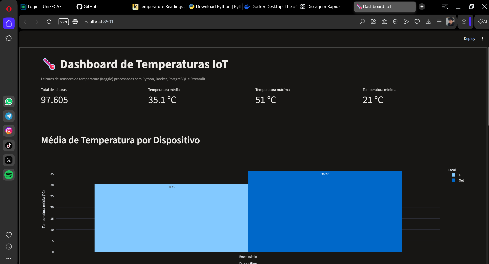
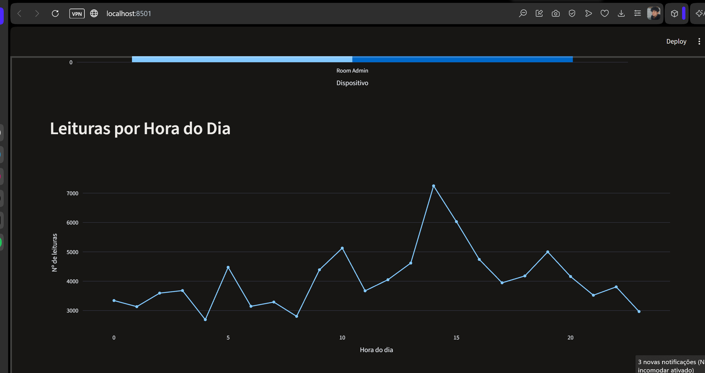
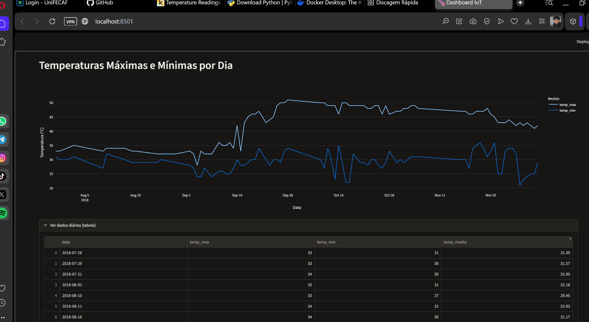

# Pipeline de Dados com IoT e Docker

Pipeline completo que lê leituras de temperatura de dispositivos IoT, armazena em um banco **PostgreSQL** rodando em **Docker** e exibe os resultados em um dashboard interativo com **Streamlit**.

Trabalho da disciplina **Disruptive Architectures: IoT, Big Data e IA** (UniFECAF).

## Tecnologias

- **Python 3** (pandas, SQLAlchemy, psycopg2)
- **PostgreSQL** (em container Docker)
- **Docker**
- **Streamlit** e **Plotly** (dashboard)
- **Git / GitHub**

## Base de dados

Dataset do Kaggle: [Temperature Readings: IoT Devices](https://www.kaggle.com/datasets/atulanandjha/temperature-readings-iot-devices)

O arquivo `IOT-temp.csv` já está na pasta `data/`. Colunas originais:

| Coluna | Descrição |
|--------|-----------|
| `id` | Identificador da leitura |
| `room_id/id` | Dispositivo/sala |
| `noted_date` | Data e hora da leitura |
| `temp` | Temperatura (°C) |
| `out/in` | Sensor interno (In) ou externo (Out) |

## Estrutura do projeto

```
pipeline-iot/
├── data/
│   └── IOT-temp.csv
├── src/
│   ├── ingestao.py      # lê o CSV, trata e insere no PostgreSQL
│   ├── views.sql        # as 3 views SQL
│   └── dashboard.py     # dashboard Streamlit
├── docs/
│   └── prints/          # capturas de tela do dashboard
├── docker-compose.yml
├── requirements.txt
└── README.md
```

## Como executar

### 1. Clonar o repositório

```bash
git clone https://github.com/Bruno2906/pipeline-iot.git
cd pipeline-iot
```

### 2. Criar o ambiente virtual e instalar as dependências

```bash
python -m venv venv
venv\Scripts\activate        # Windows
# source venv/bin/activate   # Linux/Mac
pip install -r requirements.txt
```

### 3. Subir o PostgreSQL com Docker

Com o Docker Desktop aberto:

```bash
docker compose up -d
```

Ou, alternativamente, com `docker run`:

```bash
docker run --name postgres-iot -e POSTGRES_PASSWORD=bruno123 -p 5432:5432 -d postgres
```

Confira se está rodando:

```bash
docker ps
```

### 4. Rodar a ingestão

```bash
python src/ingestao.py
```

O script lê o CSV, renomeia as colunas, converte as datas, remove nulos e duplicados e grava os dados na tabela `temperature_readings`.

### 5. Criar as views SQL

Windows (PowerShell):

```powershell
Get-Content src/views.sql | docker exec -i postgres-iot psql -U postgres
```

Linux/Mac:

```bash
cat src/views.sql | docker exec -i postgres-iot psql -U postgres
```

### 6. Rodar o dashboard

```bash
streamlit run src/dashboard.py
```

Acesse `http://localhost:8501`.

> **Observação:** para rodar a ingestão novamente depois de criar as views, apague as views antes:
> `docker exec -it postgres-iot psql -U postgres -c "DROP VIEW IF EXISTS avg_temp_por_dispositivo, leituras_por_hora, temp_max_min_por_dia;"`

## Views SQL

### `avg_temp_por_dispositivo`

Calcula a temperatura média e o total de leituras por dispositivo e por local (interno/externo). Serve para comparar o ambiente interno com o externo.

### `leituras_por_hora`

Conta quantas leituras foram registradas em cada hora do dia (0 a 23). Mostra em quais horários os sensores geram mais dados.

### `temp_max_min_por_dia`

Retorna a temperatura máxima, mínima e média de cada dia. Permite acompanhar a variação diária e a amplitude térmica ao longo do período.

## Capturas de tela do dashboard







## Insights

- O ambiente **externo é cerca de 6 °C mais quente** que o interno (média de 36,27 °C contra 30,45 °C).
- Cerca de **79% das leituras** vêm do sensor externo.
- O volume de leituras tem **pico às 14h** e vales de madrugada.
- A partir de **meados de setembro**, a temperatura máxima diária sobe de ~34 °C para ~50 °C, uma mudança de patamar que um sistema de monitoramento deveria sinalizar.
- Existem **dias sem leituras**, o que indica possíveis falhas de sensor ou de envio.

### Uso prático em ambiente real

- Alertas automáticos quando a temperatura ultrapassar um limite (ex: 45 °C).
- Avaliação de climatização e isolamento comparando sensores internos e externos.
- Detecção de sensores inativos por ausência de leituras.
- Dimensionamento da capacidade de ingestão com base no horário de pico.

## Comandos Git utilizados

```bash
git config --global user.name "Seu Nome"
git config --global user.email "seu.email@exemplo.com"
git init
git add .
git commit -m "Projeto inicial: Pipeline de Dados IoT"
git remote add origin https://github.com/Bruno2906/pipeline-iot.git
git branch -M main
git push -u origin main
```

Outros comandos usados: `git pull` (atualizar o repositório local com o remoto).

## Autor

**Bruno Martins**: [GitHub](https://github.com/Bruno2906) | [LinkedIn](https://www.linkedin.com/in/bruno-martins-065a97304)